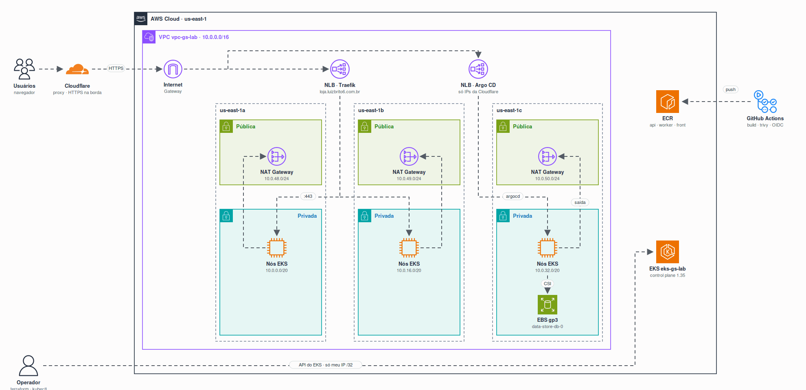

<h1 align="center">GS 02: FIAP Store no Amazon EKS</h1>

A FIAP Store roda num cluster **Amazon EKS** criado por **Terraform** e entregue por **GitOps** com o **Argo CD**. O tráfego entra pelo proxy da **Cloudflare** (HTTPS na borda), passa pelos NLBs nas subnets públicas e chega aos nós nas subnets privadas. Cada AZ tem seu NAT Gateway para a saída.

| | |
|---|---|
| Loja | https://loja.luizbrito6.com.br |
| Argo CD | https://argocd.luizbrito6.com.br/applications/argocd/fiap-store |
| Vídeo (3 min) | https://youtu.be/yPL22E25WOE (Argo CD, loja processando pedidos, APIs, kubectl, Grafana e 80/80) |
| Correção | `./avaliacao/verifica-gs.sh https://loja.luizbrito6.com.br` → **80/80** ([resultado](avaliacao/resultado-verifica-gs.txt)) |

## Arquiteturas

Cada contexto do laboratório tem o seu diagrama, junto do código que ele descreve:

| Contexto | O que mostra | Onde |
|---|---|---|
| Nuvem (AWS) | rede, cluster, balanceadores, registro e volumes | este README |
| GitOps | Terraform → Argo CD → app-of-apps → plataforma e FIAP Store | [k8s/README.md](k8s/README.md) |
| Aplicação | fluxo de requisições, fila, banco e isolamento por namespace | [app/README.md](app/README.md#arquitetura) |

## Estrutura

| Pasta | Conteúdo |
|---|---|
| [`terraform/`](terraform/) | VPC, EKS, Argo CD e Secrets, com o [passo a passo do ambiente](terraform/README.md) |
| [`terraform/ecr/`](terraform/ecr/) | repositórios ECR e role do GitHub Actions (state próprio: sobrevivem ao destroy do cluster) |
| [`k8s/`](k8s/) | tudo que o Argo CD aplica no cluster |
| [`app/`](app/) | código e Dockerfiles da FIAP Store |
| [`.github/workflows/`](.github/workflows/) | CI: build, trivy e push das imagens no ECR |
| [`avaliacao/`](avaliacao/) | script de correção, [resultado da última execução](avaliacao/resultado-verifica-gs.txt) e relatórios do trivy |
| [`docs/`](docs/) | enunciado e diagramas |

> **Terraform no lugar do `cluster.yaml`:** o enunciado sugere `eksctl`. Usamos Terraform (módulos oficiais `terraform-aws-modules`) para criar rede, cluster, Argo CD e Secrets num único `apply`, e destruir tudo num único `destroy`.

## Ambiente

Criar do zero é um `terraform apply`: o Argo CD aplica o resto sozinho. O passo a passo completo, com Secrets, acessos, ordem de destruição e problemas conhecidos, está em **[terraform/README.md](terraform/README.md)**.

| Etapa | Comando |
|---|---|
| ECR e role do CI (primeira vez) | `cd terraform/ecr && terraform apply` |
| Rede, EKS, Argo CD e Secrets | `cd terraform && terraform apply` |
| GitOps | `kubectl -n argocd get applications -w` até as 9 ficarem `Synced`/`Healthy` |
| Conferir | `AWS_PROFILE=delta ./avaliacao/verifica-gs.sh https://loja.luizbrito6.com.br` |
| Destruir | apagar a Application `root`, o PVC do banco e depois `terraform destroy` ([ordem completa](terraform/README.md#destruir)) |

## Extras

| Extra | Onde |
|---|---|
| `store-data` em Pod Security `restricted` (Postgres e Redis como não-root) | [`k8s/fiap-store/10-store-data.yaml`](k8s/fiap-store/10-store-data.yaml) |
| CI que constrói, escaneia e publica no ECR | [`.github/workflows/images.yml`](.github/workflows/images.yml) (OIDC, sem chave de acesso) |
| Manifestos com Kustomize | [`k8s/fiap-store/kustomization.yaml`](k8s/fiap-store/kustomization.yaml) |
| Prometheus e Grafana com dashboard da FIAP Store | [`k8s/monitoring/`](k8s/monitoring/) |
| TLS emitido pelo cert-manager | [`k8s/platform/cluster-issuer.yaml`](k8s/platform/cluster-issuer.yaml) |

Além do pedido: imagens com base **Chainguard** (0 vulnerabilidades no trivy) e HTTPS na borda pela Cloudflare, com os balanceadores aceitando só os IPs dela.

## Uso de IA

Usamos o **Claude Code** (Anthropic) como par de programação, num ambiente configurado por nós:

| Recurso | Para quê |
|---|---|
| Claude Code (CLI) | escrever e revisar Terraform, manifests, Dockerfiles e READMEs; investigar falhas no cluster (`kubectl`, logs, eventos) |
| Skills | `architecture-diagrams` (diagramas animados com ícones oficiais), `systematic-debugging` (investigação de causa raiz), `brainstorming` (desenho da solução antes do código) |
| Plugins | Superpowers (fluxos de trabalho: debugging, planejamento, verificação antes de concluir) e Context7 (documentação atualizada de bibliotecas) |
| Harness configurado | regras globais no `CLAUDE.md` (respostas objetivas, YAGNI, KISS, sempre conferir a documentação oficial), hooks e o RTK para reduzir saída de comandos |

Toda mudança foi revisada e aplicada por nós (`terraform apply` sempre rodado por um integrante). Qualquer integrante explica qualquer arquivo deste repositório.

## Integrantes

| Nome | RM |
|---|---|
| Anderson Huang | 565920 |
| Luiz Brito | 562192 |
