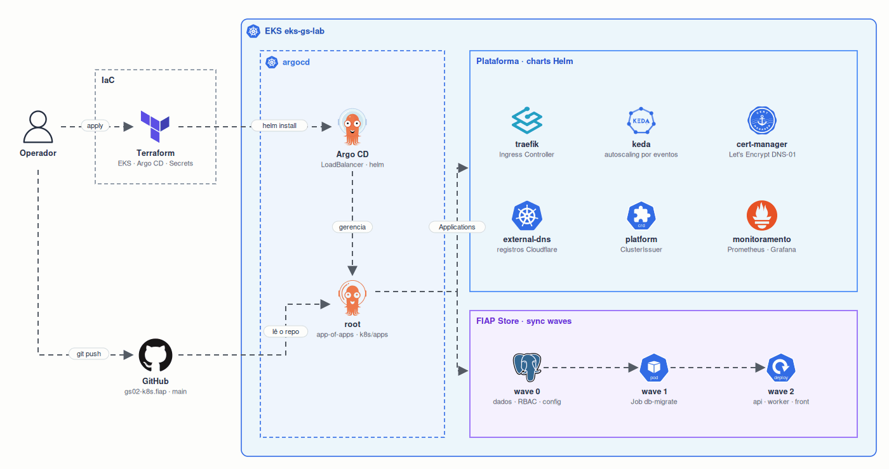

# GitOps com Argo CD

O Terraform instala o Argo CD e cria a Application `root`. Daí em diante, **o Git é a fonte da verdade**: a `root` lê `k8s/apps/` e cria uma Application para cada arquivo, todas com `prune` e `selfHeal`.

| Pasta | O que o Argo CD aplica |
|---|---|
| [`apps/`](apps/) | as Applications: traefik, keda, external-dns, cert-manager, kube-prometheus-stack, platform, monitoring e fiap-store |
| [`platform/`](platform/) | ClusterIssuer `letsencrypt` (DNS-01 na Cloudflare) |
| [`fiap-store/`](fiap-store/) | manifests da loja (Kustomize), aplicados em sync waves |
| [`monitoring/`](monitoring/) | DaemonSet node-exporter, ServiceMonitor da store-api e dashboard do Grafana |

## Sync waves da FIAP Store

| Wave | Recursos |
|---|---|
| 0 | quota, RBAC, ConfigMap, banco, Redis, NetworkPolicies |
| 1 | Job `db-migrate` (cria as tabelas antes da API subir) |
| 2 | store-api (com HPA e PDB), store-worker (KEDA), store-front, CronJob e Ingress |
